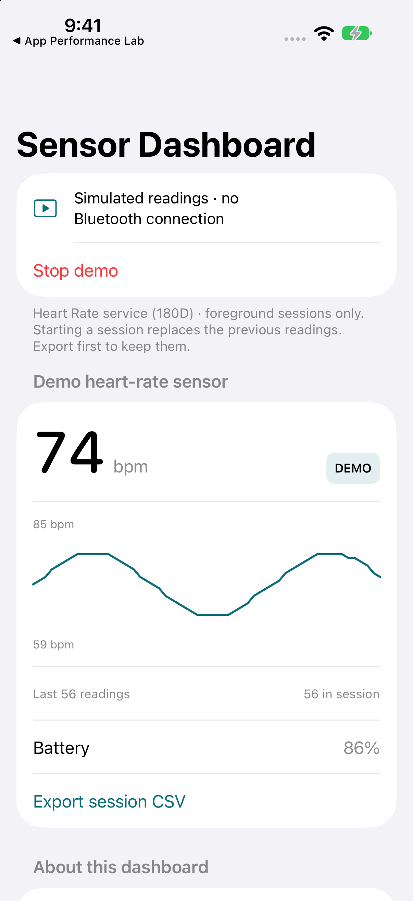

# Bluetooth Sensor Dashboard

Connect to a standard Bluetooth LE heart-rate sensor and inspect its measurements.

**iOS 15+ · iPhone and iPad · SwiftUI · MIT**



## What it does

- Scan for the Heart Rate service (180D) with a bounded 12-second scan.
- Connect, discover services, subscribe to Heart Rate Measurement (2A37), and enforce a connection/readiness timeout.
- Decode 8-bit and 16-bit heart rate, optional contact status, energy, and RR intervals.
- Read Battery Level (2A19) when the sensor supplies it.
- Inspect a chart of the last 60 readings and export up to 3,600 session readings.
- Explore a deterministic, clearly labelled demo without requesting Bluetooth permission.

## Run

Open `Bluetooth Sensor Dashboard.xcodeproj`, choose the shared **Bluetooth Sensor Dashboard** scheme, and run on an iPhone simulator or device. No third-party packages are required. Use your own signing team for a physical device; no developer-team identifier is committed.

Bundle ID: `com.dd.sensordashboard`. The deployment target is iOS 15. Initial builds were checked with Xcode 27; older OS runtime compatibility is not implied by a successful build. Xcode 16 or later is recommended for opening the project.

## Try it

In the simulator, choose **Explore demo readings**. Stop the demo and export CSV; the `source` column remains `demo` even after stopping.

For physical hardware, run on an iPhone, wake a compatible sensor, select **Scan for sensors**, grant Bluetooth permission, and select the discovered device. This app does not discover every Bluetooth device; it filters for the standard Heart Rate service. Apple Watch is not assumed to advertise this service.

Follow the [hardware checklist](Docs/Hardware.md) before claiming device compatibility.

## Structure

`HeartRateMeasurement` decodes the Bluetooth SIG packet format independently of Core Bluetooth. `SensorManager` owns scan, connect, discovery, subscription, disconnect, and timeout states on the main queue. The UI displays those states directly. Invalid or truncated packets produce an error instead of silently becoming zero readings.

## Verification

```sh
swift test
xcodebuild -project "Bluetooth Sensor Dashboard.xcodeproj" -scheme "Bluetooth Sensor Dashboard" \
  -destination 'generic/platform=iOS Simulator' CODE_SIGNING_ALLOWED=NO build
```

Core tests cover 8/16-bit values, contact status, optional energy and multiple RR intervals, malformed/truncated packets, and demo-labelled export. These tests do not establish hardware interoperability. Physical Bluetooth discovery and subscription require a compatible sensor and real iPhone.

The GitHub Actions workflow runs core tests and a simulator build. Review the actual workflow result in Actions rather than treating a badge or local build as proof of device behavior.

## Scope and limitations

This is a foreground diagnostic dashboard, not a medical device or a background fitness recorder. It does not pair arbitrary devices, interpret vendor-specific characteristics, write sensor settings, or automatically reconnect. Leaving the app ends the session. Readings remain in memory for export until another session starts or the process exits. At most 3,600 readings are retained. No physical sensor was available during initial implementation; hardware behavior remains to be verified.

## Data and privacy

[PRIVACY.md](PRIVACY.md) describes storage, permissions, and sharing. Any sample clients and demo readings are fictional.

## License

[MIT](LICENSE), including original app artwork. See [Scripts](Scripts/README.md) to regenerate icons.
